# Monopoly

A Monopoly-inspired, turn-based property game built with Java and libGDX for desktop and Android. The board is set in a pixel-art harbor town. A key sign marks a house for sale, and its tile changes to the buyer’s pawn color when purchased.

**Development status**

The desktop and Android launchers are in place. The shared entry point loads the texture atlases, bitmap font, music, sound effects, and particles. The playable board screen and turn rules are still in development.

## A turn on the board

The planned turn starts with a dice roll. Move your pawn, then resolve the space where it lands. On an available property, decide whether to pay the price or save your cash. Other spaces can charge a fee, award treasure, or swap two pawns’ positions.

## Player figures

A pawn marks a player’s position. When that player buys a house, its tile takes the same color as the pawn.

| | Blue | Red | Yellow | Green |
| --- | --- | --- | --- | --- |
| **Pawn** |  | 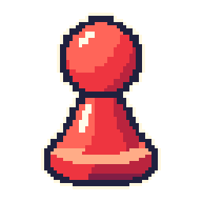 |  | 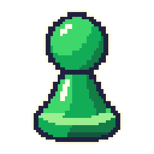 |
| **Owned property** | 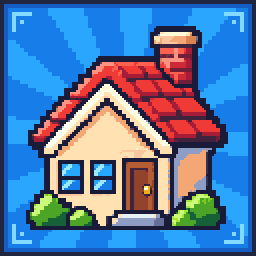 | 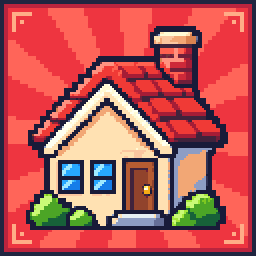 | 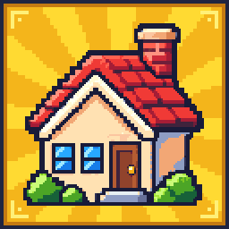 | 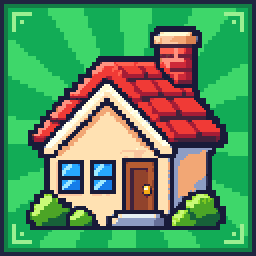 |

## Board tiles

The key sign on the Property tile marks a house that is still for sale. The table describes the planned rules for all 14 tile types.

| Icon | Tile | Rule |
| --- | --- | --- |
| 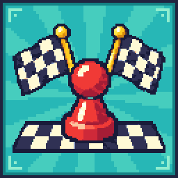 | **Start** | Collect **€500** every time you pass Start. |
| 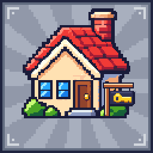 | **Property** | You can buy an unowned house for its displayed price. If another player owns it, pay rent to that player. |
| 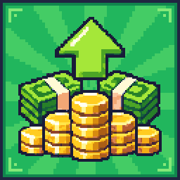 | **Money reward** | Receive a cash reward. |
| 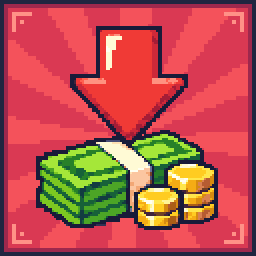 | **Fee (tax)** | Pay a tax from your cash balance. |
|  | **Bank** | Receive a bonus equal to **10% of your current cash**. For example, if you have €800, you receive €80. |
| 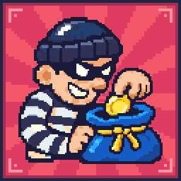 | **Robbery** | Choose an opponent and steal **€300** from them. |
| 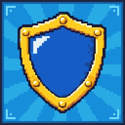 | **Shield** | Gain a shield that protects you from the next attack. |
| 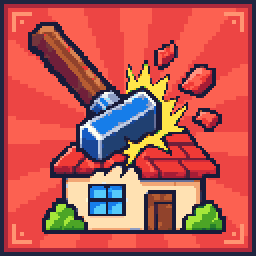 | **Destroy (sabotage)** | Choose a property owned by an opponent and lower its level. |
| 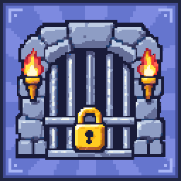 | **Jail** | To get out of jail, roll the randomly chosen target number or higher. |
| 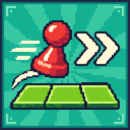 | **Skip (boost)** | Move forward **3 spaces**. |
| 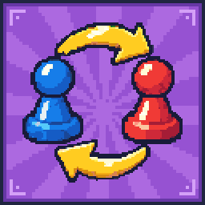 | **Switch** | Choose an opponent and swap board positions with them. |
| 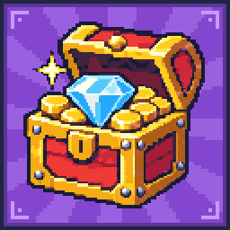 | **Treasure chest** | Receive a random weapon. |
|  | **Trophy** | Collect **1 trophy**. |
| 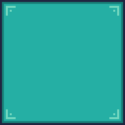 | **Blank** | End your move here without triggering a tile effect. |

## Entity–component–system design

The shared Java module includes **Ashley** for the game’s entity–component–system (ECS) architecture. In the planned design, players and board spaces are entities. Components hold data such as a pawn’s board position, a player’s balance, or a property’s price and owner. Systems handle movement, purchases, and rendering.

For example, buying a house deducts the price from the buyer’s balance and assigns ownership to that player. The renderer can then choose the matching tile, and the audio system can play the purchase sound.

## Run locally

Use a JDK (17 or later) and the Gradle wrapper included in `Game/`. From the repository root, launch the desktop build with the commands for your platform.

**Windows PowerShell**

```powershell
cd Game
.\gradlew.bat :lwjgl3:run
```

**macOS or Linux**

```sh
cd Game
sh ./gradlew :lwjgl3:run
```

For Android, install Android SDK Platform 36 and run the wrapper with `:android:assembleDebug` from the same directory. The debug APK is written to `android/build/outputs/apk/debug/`.

## Project layout

| Directory | Contents |
| --- | --- |
| [Game/core](Game/core/) | Shared Java code, game entry point, and asset definitions |
| [Game/lwjgl3](Game/lwjgl3/) | Desktop launcher, source sprites, and texture packer |
| [Game/android](Game/android/) | Android launcher and packaging |
| [Game/assets](Game/assets/) | Packed textures, font, particle definitions, and audio loaded by the game |

## License

This project is licensed under the [MIT License](LICENSE).
